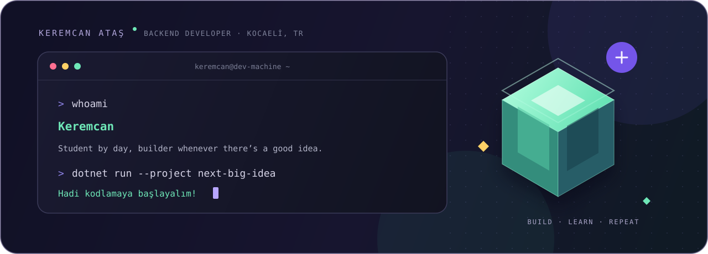
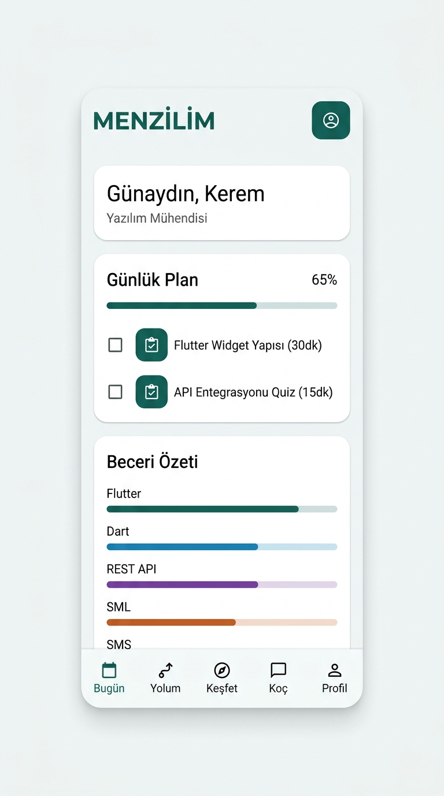

<div align="center">
  

  <br>

  <a href="https://github.com/Keremcanatass-58/ritma"></a>
  <a href="https://kartistt.com.tr"></a>
  <a href="https://www.linkedin.com/in/keremcan-atas"></a>
</div>

<br>

## Hey, I'm Keremcan! 👋

I’m an **Internet & Network Technologies student in Kocaeli, Türkiye** who likes turning “what if we built this?” into an actual app. Most days that means C#, .NET, a little too much coffee, and one more tiny detail before I call it done. ☕

```text
🎒 Currently:  learning by building
🧭 Looking for: an internship or junior backend role
🧪 Exploring:   testing, clean architecture & cloud deployment
🐛 Status:     the bug is probably one line above
```

## 🕹️ Projects from my little corner of the internet

### 🧭 [MENZİLİM](https://github.com/Keremcanatass-58/menzilim) — turn career goals into real progress

A personal professional-development platform that connects a career goal to a learning path, daily actions, skill growth, and a project that develops step by step.

`Flutter` · `ASP.NET Core` · `.NET 10` · `EF Core` · `SQL Server`

<p align="center">
  <a href="https://github.com/Keremcanatass-58/menzilim">
    
  </a>
</p>

<p align="center"><sub>Goal → Path → Today → Learn → Build → Grow</sub></p>

### 🗓️ [Ritma](https://github.com/Keremcanatass-58/ritma) — fewer calendar headaches

A booking and business workspace where customers can book online and businesses can manage appointments, services, staff, and payments.

`C#` · `ASP.NET Core` · `.NET 10` · `SQL Server`

<a href="https://github.com/Keremcanatass-58/ritma">
  
</a>

<sub><a href="https://github.com/Keremcanatass-58/ritma/tree/main/docs/screenshots">Peek at more screens →</a></sub>

### 🎨 [Kartist](https://github.com/Keremcanatass-58/Kartist-Editor) — ideas, meet canvas

An AI-powered design studio for business cards and invitations, with a canvas editor and a live community feed. [Take it for a spin ↗](https://kartistt.com.tr)

`ASP.NET Core 8` · `SignalR` · `Fabric.js` · `SQL Server`

<a href="https://kartistt.com.tr">
  
</a>

### 📂 [SmartOrganizer](https://github.com/Keremcanatass-58/SMART-ORGANIZER) — find that file

A Windows desktop file organizer I made for my Visual Programming final project. It sorts, searches, and opens files from one place.

`C#` · `WinForms` · `.NET Framework`

## 🧰 My toolbox

<p>
  
  
  
  
  
  
</p>

**Also exploring:** Entity Framework Core · Dapper · SignalR · HTML/CSS · Flutter · GitHub Actions

## ☕ A few non-code facts

- 🎓 Studying Internet & Network Technologies in Kocaeli.
- 🐛 I enjoy debugging. The bugs are still deciding how they feel about me.
- 🎧 Good music makes a stubborn bug at least 12% less stubborn. *(Unofficial research.)*
- 🤝 Open to internship and junior backend opportunities, remote or hybrid.

<div align="center">
  <br>
  <b>Got a fun problem to solve? My terminal is open.</b><br><br>
  <a href="https://www.linkedin.com/in/keremcan-atas">LinkedIn</a> ·
  <a href="mailto:keremcanatass13@gmail.com">Email</a> ·
  <a href="https://github.com/Keremcanatass-58">GitHub</a>
</div>
