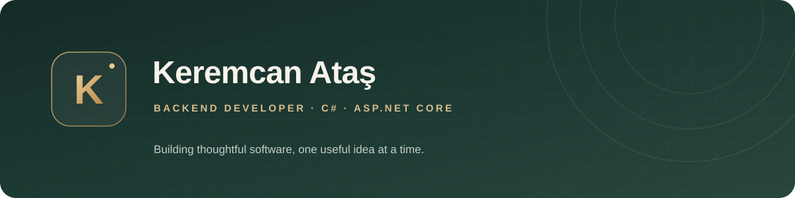

  

   

  
  
  

## 👋 Hey, I'm Keremcan

I'm a backend-focused developer from **Kocaeli, Türkiye**, studying Internet & Network Technologies. I enjoy turning practical problems into useful products—with clean APIs, thoughtful details, and the occasional coffee-fuelled refactor. ☕

I work mostly with **C#, ASP.NET Core, and SQL Server**, and I like exploring the full journey from a solid backend to a product people enjoy using.

## 🚀 Things I'm building

| Project | What it does | Built with |
| --- | --- | --- |
| [**Ritma**](https://github.com/Keremcanatass-58/ritma) | Appointment and business management for service-based businesses. Bookings, staff, services, and payment tracking in one workspace. | `.NET 10` · `ASP.NET Core` · `EF Core` · `SQL Server` |
| [**Kartist**](https://github.com/Keremcanatass-58/Kartist-Editor) · [Live demo ↗](https://kartistt.com.tr) | An AI-powered design studio with a social feed—make a design, polish it, and share it. | `ASP.NET Core` · `SignalR` · `Fabric.js` · `SQL Server` |
| [**SmartOrganizer**](https://github.com/Keremcanatass-58/SMART-ORGANIZER) | A Windows desktop helper that sorts everyday files and makes them easier to find. | `C#` · `WinForms` · `.NET` |

> **On the workbench:** Menzilim, a personal development platform—currently taking shape.

## 🧰 My toolbox

**Backend**　    

**Data**　 

**Also exploring**　    

## 🌱 A little more about me

- 🎓 Learning Internet & Network Technologies in Kocaeli.
- 🧪 Getting better at clean architecture, testing, and cloud deployment.
- 🤝 Open to **internship and junior backend opportunities**—remote or hybrid.
- 💡 Always happy to talk about product ideas, APIs, and what makes software feel effortless.

## 📬 Say hello

[LinkedIn](https://www.linkedin.com/in/keremcan-atas) · [Email](mailto:keremcanatass13@gmail.com) · [Kartist live demo](https://kartistt.com.tr)

   
  <i>Building useful things, one thoughtful commit at a time. ✨</i>

