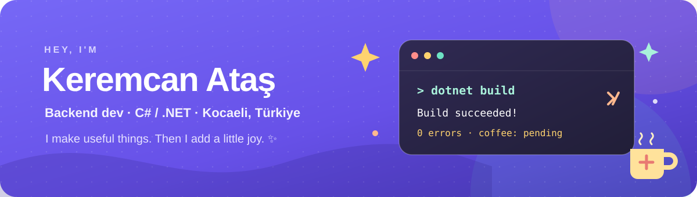

  

   
   

  🗓️ <a href="https://github.com/Keremcanatass-58/ritma">Meet Ritma</a>
  &nbsp; · &nbsp;
  🎨 <a href="https://kartistt.com.tr">Try Kartist live</a>
  &nbsp; · &nbsp;
  💬 <a href="https://www.linkedin.com/in/keremcan-atas">Say hello</a>

---

## Hey, I'm Keremcan! 👋

I’m an Internet & Network Technologies student in **Kocaeli, Türkiye**, building practical things with **C# and .NET**. I like clean APIs, thoughtful little details, and software that makes someone’s day a bit easier. I also like coffee. A lot. ☕

🔭 **Current side quest:** building Ritma  
🧭 **Looking for:** an internship or junior backend role  
🧪 **Learning:** testing, clean architecture, and cloud deployment

## 🎮 Things I've made

### 🗓️ [Ritma](https://github.com/Keremcanatass-58/ritma) — less calendar chaos

A booking and business workspace: customers book online; businesses keep schedules, services, staff, and payment status in one place.

`C#` · `ASP.NET Core` · `.NET 10` · `SQL Server`

That’s the real dashboard, with demo-safe data. <a href="https://github.com/Keremcanatass-58/ritma/tree/main/docs/screenshots">See desktop and mobile views →</a>

### 🎨 [Kartist](https://github.com/Keremcanatass-58/Kartist-Editor) — ideas, meet canvas

An AI-powered design studio for business cards and invitations, with a canvas editor and a live community feed. [Go try it ↗](https://kartistt.com.tr)

`ASP.NET Core 8` · `SignalR` · `Fabric.js` · `SQL Server`

Explore <a href="https://kartistt.com.tr">Kartist ↗</a>

### 📂 [SmartOrganizer](https://github.com/Keremcanatass-58/SMART-ORGANIZER) — find that file

A Windows desktop file organizer I built as my Visual Programming final project. It sorts, searches, and opens files from one place.

`C#` · `WinForms` · `.NET Framework`

> 🛠️ **On the workbench:** Menzilim, a personal development platform. Still in the “make it real” phase.

## 🧰 My everyday toolkit

**Building:** C# · ASP.NET Core · Entity Framework Core · Dapper · SignalR  
**Keeping data:** SQL Server · T-SQL  
**Exploring:** JavaScript · HTML/CSS · Flutter · GitHub Actions

## ☕ Outside the terminal

- 🎓 Studying Internet & Network Technologies in Kocaeli.
- 🐛 I enjoy debugging; the bugs just don’t enjoy being found.
- 🤝 Open to internship and junior backend opportunities, remote or hybrid.

   
  <b>Have a good problem? I like those.</b> 
  <a href="https://www.linkedin.com/in/keremcan-atas">LinkedIn</a> ·
  <a href="mailto:keremcanatass13@gmail.com">Email</a> ·
  <a href="https://github.com/Keremcanatass-58">GitHub</a>

